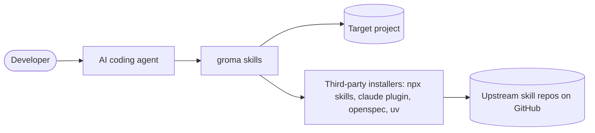

# Architecture

## System context

A developer runs `/groma` inside an agent (Claude Code, Copilot, Gemini CLI, Cursor, Codex). The agent follows the skills, reads the target project, writes new files into it and calls third-party installers, or lists their commands in `.groma/install.sh`.

## Containers

| Container | Technology | Responsibility | Evidence |
|---|---|---|---|
| Skills | Markdown (Agent Skills format) | Procedure for each step | `skills/*/SKILL.md` |
| Runtime scripts | POSIX sh | Detection, freshness, config validation, change ids, schema dump | `skills/*/scripts/` |
| Templates and references | Markdown, YAML | Docs and agent file templates, stack tables, skill catalog | `skills/*/templates/`, `skills/*/references/`, `skills/groma-skills/catalog.yaml` |
| Distribution manifests | JSON | Plugin and extension metadata per agent | `.claude-plugin/`, `.codex-plugin/`, `.cursor-plugin/`, `gemini-extension.json`, `install.sh` |
| Test suite (not shipped) | sh, bats, Python via uv | Structure checks, script tests, invariant, evals | `scripts/test.sh`, `tests/` |

## Building blocks

- `groma`: orchestrator, owns `config.yaml` template, `check-prereqs.sh`, `validate-config.sh`.
- `groma-detect`: `detect.sh` plus `references/signals.md`.
- `groma-survey`: `freshness.sh`, `dump-schema.sh`, ADR and data-source tables, findings template.
- `groma-lay-out`: doc templates and `doc-slots.md`.
- `groma-methodology`: `next-change-id.sh`, `check-conventions.sh`, `roadmap.sh` (share `lib-changes.sh`).
- `groma-skills`: `catalog.yaml` and `references/install.md`.
- `groma-agents`: templates for `AGENTS.md`, `CLAUDE.md`, `GEMINI.md`, `copilot-instructions.md`, `groma.mdc`.

The orchestrator refers to siblings by relative path (`../groma-detect/`). A skill never calls another skill's scripts except through that documented sibling path, and every skill works alone.

## Runtime view

`/groma` in init mode: detect → interview → write `.groma/config.yaml` → methodology → skills → docs (survey first on brownfield) → agents → summary. After each step `steps.<name>` becomes `done`, `pending` or `skipped`. A later run validates the config and resumes at the first `pending` step.

## Deployment

Distributed from GitHub (`Zeotyn/groma`) as a Claude Code / Copilot plugin marketplace, via `npx skills add`, as Codex, Cursor and Gemini manifests, and through `install.sh`. Nothing runs as a service.

## Decisions

Architecture decisions are recorded in [adr/](adr/README.md).
