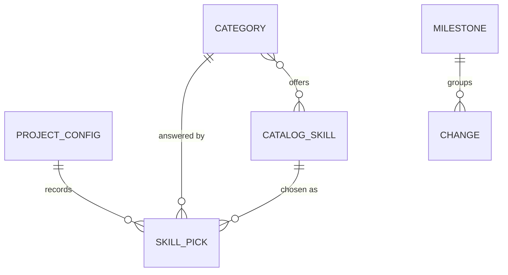

# Data model

Statements are tagged **EXTRACTED** (read from migrations, schema files or a schema dump) or **INFERRED** (derived from code, needs review). The physical schema is not copied here; see [Physical schema](#physical-schema).

groma has no database. Its persistent data are files it writes into target projects and the catalog it ships.

## Conceptual model

A **project config** records the choices of one groma run: the methodology, the agents and one skill pick per **catalog category**. Each pick refers to a **catalog skill**. Generated **docs** carry freshness frontmatter. **Changes** are named with a change id and may belong to a **milestone**.

## Logical model

| Entity | Key attributes | Relationships | Source | Tag |
|---|---|---|---|---|
| Project config | `schema`, `initialized_with`, `project.name`, `project.has_ui`, `project_type`, `methodology`, `workflow`, `agents`, `steps.*` | has one skill pick per category | `skills/groma/templates/config.yaml` | EXTRACTED |
| Category | id, `select` (single/multi), `condition`, `recommended`, `options` | offers catalog skills | `skills/groma-skills/catalog.yaml` | EXTRACTED |
| Catalog skill | id, `source`, `ref`, `skills`, `claude_plugin`, `marketplace`, `install`, `post_install` | listed in categories | `skills/groma-skills/catalog.yaml` | EXTRACTED |
| Doc | `title`, `status`, `last_reviewed`, `review_after_days`, `owner`, `sources` | fills one doc slot | `skills/groma-lay-out/templates/docs/` | EXTRACTED |
| Change | id `<type><NNN>-<slug>`, optional `Milestone: mNNN` line | belongs to at most one milestone | `skills/groma-methodology/references/conventions.md` | EXTRACTED |

## Invariants

- A change id is never reused; numbers count per type and include archived changes.
- `workflow` is stored top-level, every other category under `skills.<category>`.
- `design` is `none` when `project.has_ui` is false.
- Every pick names an option of its category (checked by `validate-config.sh`).

## Physical schema

The authoritative formats live in: `skills/groma/templates/config.yaml`, `skills/groma-skills/catalog.yaml`, validated by `skills/groma/scripts/validate-config.sh`.

## Drift

None found.
